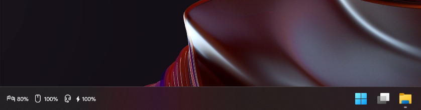

# Wireless Battery Tray

[](https://github.com/Faulik/wireless-battery-tray/actions/workflows/ci.yml)
[](https://github.com/Faulik/wireless-battery-tray/releases/latest)

Battery levels of your wireless keyboards, mice, headsets and controllers, right on the Windows
taskbar of the monitor you choose.

<p align="center"></p>

**[Website](https://battery.faulcloud.work/)** ·
**[Download](https://github.com/Faulik/wireless-battery-tray/releases/latest)**

## Features
- One icon per device (keyboard, mouse, headset, headphones, earbuds, gamepad) with its
  percentage; ⚡ while charging, red below your low-battery level.
- Lives inside the taskbar, next to the clock or on the left, on any monitor. Hides with the
  taskbar (full-screen apps, auto-hide) and follows the light/dark theme.
- Disconnected devices are hidden (or shown dimmed). When two devices share an icon, a short name
  tag tells them apart.
- Hover for full names and connection; double-click for Settings, right-click for the menu.
- Settings with a live preview: show/hide, order, icon and tag per device, monitor, position,
  text size, a compact two-row mode, low-battery level and poll interval.
- Only ever reads from devices: every request it sends is a read/query.
- Optional update check (see [Updates](#updates)).

## Install
1. Download `wireless-battery-tray.exe` (or the zip) from
   [Releases](https://github.com/Faulik/wireless-battery-tray/releases/latest).
2. Put it anywhere, e.g. `%LOCALAPPDATA%\Programs\Wireless Battery Tray\`, and run it.
3. Windows SmartScreen may warn that the app is unrecognised (it isn't code-signed): choose
   **More info → Run anyway**.
4. To start it at login, tick **Start with Windows** in the tray menu or Settings.

Windows 10/11, x64. The zip also contains `wbt.exe`, a command-line tool that prints every
battery once (`wbt --json` for JSON).

## Supported devices
| Device / family | Connection | Battery | Charging | Notes |
|---|---|---|---|---|
| Bluetooth headsets, earbuds and other devices that report battery to Windows | Bluetooth classic | ✓ | – | Read from the battery value Windows shows in Settings → Bluetooth |
| BLE keyboards and mice (Battery Service) | Bluetooth LE | ✓ | – | Every battery characteristic, so split keyboards can show both halves |
| Logitech devices on Unifying, Bolt and Lightspeed receivers | 2.4 GHz receiver | ✓ | ✓ | HID++ 2.0; works alongside Logi Options+ |
| SteelSeries Arctis Nova 7 family | 2.4 GHz dongle | ✓ | ✓ | |
| Sony DualShock 4 | Bluetooth, USB | ✓ | ✓ | |
| Keychron keyboards on a Keychron Link receiver | 2.4 GHz receiver | – | – | Listed as connected only; see below |

Device type is worked out from the BLE appearance, the Bluetooth class of device, the Windows
device category and finally the model name. Settings → Details shows which one decided.

## Known limitations
- **Keychron keyboards over 2.4 GHz** (e.g. K3 HE on a Keychron Link): the receiver doesn't
  pass a battery level on, so they only show as connected. In Bluetooth mode they report battery
  normally.
- **Logitech MX Master 3 while charging** reports no level, only that it is charging, so you see
  just the ⚡ until it reports a level again.
- **ZMK split keyboards** (e.g. Glove80) only show the central half unless the firmware is built
  with `CONFIG_ZMK_SPLIT_BLE_CENTRAL_BATTERY_LEVEL_PROXY=y` (and
  `CONFIG_ZMK_SPLIT_BLE_CENTRAL_BATTERY_LEVEL_FETCHING=y`); then both halves appear.
- **SteelSeries Arctis** headsets on older firmware report battery in 25% steps.
- **DualShock 4** reports in 10% steps, and is invisible to other apps when DS4Windows with
  HidHide is hiding it.

## Configuration
Settings are saved to `%APPDATA%\wireless-battery-tray\config.toml` as you change them. You can
also edit the file while the app isn't running:

| Key | Default | Meaning |
|---|---|---|
| `monitor` | primary | Monitor to show the strip on, e.g. `\\.\DISPLAY2` |
| `position` | `Right` | `Right` (next to the tray) or `Left` |
| `offset` | `0` | Extra distance from the tray (Right) or the left edge (Left), in pixels |
| `text_size` | `9.0` | Text size in points |
| `compact` | `false` | Two rows instead of one |
| `low_threshold` | `20` | Percent below which a level turns red |
| `poll_secs` | `60` | Seconds between battery reads |
| `show_offline` | `false` | Show disconnected devices dimmed |
| `check_updates` | `true` | Check GitHub for new releases |
| `[[devices]]` | | One entry per device seen: `show`, `display`, `label`, `icon` |

## Updates
30 seconds after start and then once a day, the app asks GitHub for the latest release. If there
is a newer one, the tray icon gets a blue dot and the menu offers **Update to vX.Y.Z**. Clicking it
downloads `wireless-battery-tray.exe`, checks it against the release's `SHA256SUMS.txt`, swaps it
in and restarts. Nothing is installed without that click. Settings → Updates turns the check off
or runs it now.

<details>
<summary><b>Build from source</b></summary>

Needs the MSVC Rust toolchain (`rustup default stable-x86_64-pc-windows-msvc`), Rust 1.84+.

```
cargo run --release --bin wireless-battery-tray   # taskbar strip + tray icon
cargo run --release --bin wbt                     # one-off table in the terminal (--json for JSON)
```

Set `BATTERIES_DEBUG=1` to print what each provider sees.

Layout:
- `crates/battery-core`: `Battery`, `Level`, `Kind`, the `Provider` trait, kind detection, merging.
- `crates/providers`: one module per source (`pnp`, `gatt`, `logitech`, `steelseries`,
  `dualshock`, `keychron`).
- `crates/cli`: the `wbt` binary.
- `crates/bar`: the `wireless-battery-tray` strip, tray, settings window and updater.

Releases are automatic: every push to `main` that passes CI and changes more than docs is
released as the next patch version (`v0.1.1` → `v0.1.2`). For a minor or major release, set the
new `version` in the workspace `Cargo.toml`; the higher of the two wins. Pushing a `vX.Y.Z` tag
that matches `Cargo.toml` still releases that tag. See `.github/workflows/release.yml`.
</details>

## Acknowledgements
Protocol references, with thanks:
[Solaar](https://github.com/pwr-Solaar/Solaar) (Logitech HID++),
[HeadsetControl](https://github.com/Sapd/HeadsetControl) (SteelSeries) and the Linux kernel's
[hid-playstation](https://github.com/torvalds/linux/blob/master/drivers/hid/hid-playstation.c)
driver (DualShock 4). No code was copied from them.

## License
[MIT](LICENSE)
